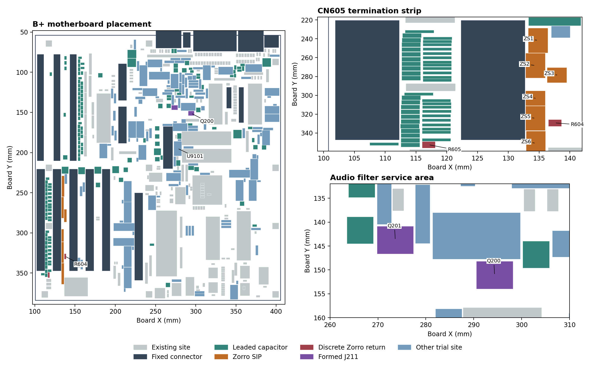

# Scenario B+ — Commodore-authentic EATX

**Selected design direction. The completed design targets 342 through-hole and 204 surface-mount packages, or 62.6% THT.** The design starts at accepted commit `50d8927`. It preserves two documented discrete Zorro returns, uses traditional through-hole SIPs for the rest of the eligible bank, and takes the compact axial and formed JFET options from Scenario C. Greg accepted the historical baseline at dee224d and approved the revised socket for development layout. The current implementation and manufacturing decisions are recorded in the [branch review](SCENARIO_B_PLUS_IMPLEMENTATION.md) and [connector resolution](coupon/CONNECTOR_RESOLUTION.md). [Historical comparison](ORIGINAL_A2000_REV62_COMPARISON.md) · [Coupon projects, fabrication files and BOM](coupon/README.md)

## Population and electrical decisions

| Measure | Accepted B | Proposed B+ | Reason |
|---|---:|---:|---|
| CN605 returns | 46 ways in 6 SIPs | 44 ways in 6 SIPs + 2 axials | Factory drawing shows R604/BD10 and R605/BD1 as individual grounded returns. Retain a separate private capacitor junction for each. |
| Further changes from B | — | Q200 and Q201 SMD → formed TO-92 J211 candidates | A pair of serviceable discrete audio switches follows historical construction. Pin mapping, bias, filter response and installed height are qualification conditions. |
| Original EATX design positions realised in THT | 378 / 584 | 380 / 584 (65.1%) | The numerator counts each resistor element once. Includes 315 of the 519 originally surface-mounted positions. |
| Physical package population | 338 / 544 THT | 342 / 546 THT (62.6%) | 44 EATX resistor references occupy six bodies, reducing the package denominator by 38. The two axial returns increase the number of bodies compared with B. |

The register assigns one class to each physical package. A = original-style THT (165), B = equivalent THT substitution (177), C = necessary SMD under present electrical constraints (116), D = optional SMD with a specific further trial (49), E = unresolved evidence or engineering risk (39). A grades the construction style. A period-correct PDIP can carry a later EATX logic family and still require a full electrical timing check. C includes the 60 four-land feedthroughs, three SRAM/interface devices and local bypass/damping parts. E includes regulator, ferrite, protection, RTC and oscillator questions. D preserves C's alternative placement work, including additional bypass, fast-DIP and control-path options. The 584 positions include mutually exclusive assembly options and exclude the baseline's 17 etched jumpers, 11 mounting holes and two graphics. The package fraction will vary by build option. [Per-reference classification, package IDs and release conditions](audit/rev62/bplus-components.csv) · [A/B/C alternatives](THT_LAYOUT_FEASIBILITY.md)

## Accepted placement study at dee224d

The whole-board view uses the production outline. The expansion inset expands its horizontal axis to make the narrow rows legible. Coordinates are in the R3.1 KiCad board frame. The placement file lists electrical pad centres, body envelopes and rotation for each proposed move. Existing footprints absent from that file keep their audited placement. Board outline, all 11 mounting centres, rear I/O, Zorro, ISA, CPU and video connector locations remain fixed. Use actual fully inserted cards and the tray standoffs for the height and underside fit check. [B+ coordinates](audit/rev62/bplus-placement.csv) · [Fixed lands and mount coordinates](audit/baseline/pcb-pads.csv)

- **Zorro.** Give the 46 capacitor signal lands first choice of space beside CN605. Use four 10-pin and two 6-pin SIPs, with pin 1 grounded on each. Leave ZS5.9 and ZS6.7 externally open. Mark pin 1 on the board and place the resistance beside the reference. C665.1 → R604.2 has an 18.5 mm Manhattan endpoint distance. C666.1 → R605.2 has 4.0 mm. Each axial pin 1 returns independently to GND. Actual routed lengths and loaded response decide whether these placements survive. Leave C675/R606 at their CN601 grant tap. [All branch assignments](audit/rev62/termination-crosswalk.csv)
- **ISA.** Keep the existing five SIPs, their ground lands and the separate +5 V pull-up. Stagger radial 1 nF signal capacitors beside CN702. Preserve byte-extended contacts and each private junction. Measure on a bridgeboard with real ISA loading before adopting the radial bank. [Historical vs EATX contact mapping](ORIGINAL_A2000_REV62_COMPARISON.md)
- **Audio.** Use C's formed TO-92 envelopes in free space near the filter. Q200 centre is (294.352, 151.089) mm and Q201 is (273.622, 143.741) mm. Both moved from C's independent trial to fit the B population. Keep gate bias and high-impedance routes short and away from bus traces. Each trial has one pad near an existing drilled feature. Correct those conflicts in a future approved re-layout or retain the SMD part. [Drill screen](audit/rev62/bplus-drill-screen.csv)
- **Logic, power and service.** Use conventional resistor rows for original discrete bias/analogue functions. Group DIPs with their own bypass/return pairs and align notches within each functional group. Keep socket extraction clear of adjacent cans and tall cards. Group the front-side standby circuit with its RC components. Place rail electrolytics with visible polarity after checking the sign of the rail. Keep underside access to the Agnus links. Use green mask, white silkscreen, readable refs, connector pin-one marks and normal functional labels. Preserve project attribution, existing notices and licence. Identify the board as Jason Beer's EATX derivative.
- **Routing.** Keep the four-layer 1.6 mm stack. The screen covers 1,064 trial plated pads. Of these, 61 are near existing drilled features and 50 are near existing inner traces; categories can overlap. The screen uses a 1.0 mm trial drill, 1.8 mm pad, 0.25 mm hole clearance and 0.20 mm copper clearance. Future routing must resolve each hit and preserve return paths around H7, ground continuity, rail cross-section, thermal relief and decoupling loops. The placement study preceded the two routed motherboard sections documented in the implementation review. [Per-part screen](audit/rev62/bplus-drill-screen.csv)

## SIP qualification

The audit gives a modern candidate for **each installed or proposed SIP package**, all physical pins, ground or supply common, isolated adjacent pairs where applicable, body dimensions, effective power limits, supplier listing and source. The 4600X-101 parts share pin 1. On 4600X-102 parts each adjacent pair is independent. Ratings vary with ambient and the aggregate package rating can bind before the element limit. Verify the body/lead drawing, pin-one mark and resistance matrix on incoming samples. For a 5 V step across a 1 kΩ element the initial ideal dissipation is 25 mW. A nine-way simultaneous step gives 225 mW before RC decay. Common-lead inductance and mutual capacitance are unspecified in the family data. Electrical release depends on the loaded fixture. [SIP audit](SIP_NETWORK_AUDIT.csv) · [Bourns 4600X specifications](https://bourns.com/docs/Product-Datasheets/4600x.pdf)

## Review and risk register

| Item | Existing evidence or risk | Required disposition |
|---|---|---|
| Historical revision | Factory RP604 is 1 kΩ on the 6.0 list and Rev 6 schematic. Later references say 470 Ω. Donor scans lack component markings. | Accept retaining Jason's 1 kΩ. A donor photograph or isolated resistance measurement can resolve the fitted historical variant. Keep any value change a separate proposal. |
| Zorro SI | Single vs shared grounds, longer private nodes, socket loading and simultaneous switching can change threshold crossings. | Approve the three fixture assemblies for comparison after mechanical review. Use the acceptance plan, then test the full motherboard with real receivers and cards. No laboratory result has been recorded. |
| ISA | Inherited CN700–702 row spacing is 4.8514 mm versus a referenced 5.08 mm connector. The historical misconnection of the D15 termination is separately documented. | Dry fit the specified socket. Submit any connector geometry correction separately. Retain EATX C789 on the D15 data contact. |
| Zorro connector | The accepted historical study identified the 0.80 mm production hole. The five revised sockets now use the TE 4.85 mm row spacing and layer-specific annuli. | Layout approval granted. Supplier manufacturing qualification, actual fit, thermal and electrical measurements remain open. [Engineering resolution](coupon/CONNECTOR_RESOLUTION.md) · [Implementation and verification](SCENARIO_B_PLUS_IMPLEMENTATION.md) |
| Original ERC, DRC and net partition | `d14bc6e` records 24 ERC errors, 1,182 ERC warnings, 85 stored-fill DRC thermal findings, 202 DRC warnings, 17 parity warnings and zero unrouted nets. Later disposable refill gave 82 thermal errors. | Track all original findings by reference. Preserve 3,631 schematic pin assignments on 858 nets, 3,726 physical pad records including 14 grounded pad-0 shell lands. Compare individual pads and expanded SIP connectivity after any approved board change. [Inherited finding register](audit/layout/baseline-error-triage.csv) |
| LF347, power and service clearance | U204 sections B/D have an inherited symbol input-sign issue. Negative rail polarity, −5 V regulator dissipation, DIP height, manual solder access and standby timing depend on real parts and loading. | Check pins 5/12 non-inverting and 6/13 inverting at pads. Keep any symbol-only correction separate. Verify polarity, thermals, probe access, audio and switch/reset timing on an instrumented build. |
| Mechanical and power integrity | Placement uses projected footprints. A planar fit or CAD design-rule pass cannot establish card height, solder-tail/tray clearance, fast-loop impedance or plane neck temperature. | Review a 1:1 print, connector/body drawings and actual full-length cards. Refill and inspect both internal layers after routing. Measure rail droop and timing at device pins. |
| Alternatives if SIP or JFET trials fail | Baseline SMD and Scenario C's separate axial returns both remain available. A lower THT count is acceptable. | Use measured performance and approved system margins to select the bank. Recount packages for the chosen fitted assembly. |

Supplier acceptance, first-article inspection and measured electrical margins remain open. [Coupon readiness](coupon/FABRICATION_READINESS.md) · [Measurement criteria](coupon/MEASUREMENT_PLAN.md)
