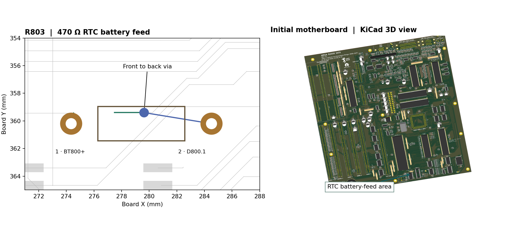
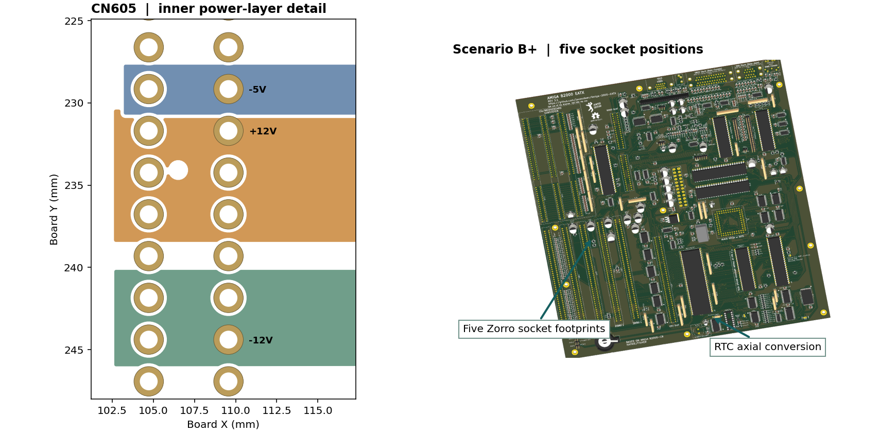

# Scenario B+ development review

Greg selected the Commodore-authentic construction direction at `dee224d91d5750c5a60abf4027df23123f4dec46` and provisionally approved the revised TE geometry on 20 November 2026. This branch contains the initial motherboard implementation and the three checked termination fixtures. Fabrication, electrical acceptance and a merge require subsequent decisions. [Connector engineering resolution](coupon/CONNECTOR_RESOLUTION.md) · [Coupon manufacturing readiness and equipment](coupon/FABRICATION_READINESS.md) · [Historical and population baseline](SCENARIO_B_PLUS_DESIGN.md)

## RTC battery feed

R803 is the 470 Ω resistor between BT800 positive and the D800 pin-one node on the Buster/RTC sheet. The initial section replaces the 1206 package with a DIN0207 horizontal axial, 6.3 × 2.5 mm body, 10.16 mm pitch. Pin 1 is at (274.35, 360.20) mm and pin 2 at (284.51, 360.20) mm. The physical centre is (279.43, 360.20), displaced (+3.40, +0.80) mm from the planning envelope. This placement clears the existing copper and RTC package. One 0.65 mm land / 0.30 mm drill via at (279.63, 359.40) carries the D800-side branch to B.Cu. Both extensions use 0.25 mm copper. U801's *value legend* moved (−3.0, −4.5) mm to clear R803, with the RTC itself at its original location. The schematic instance now specifies the axial footprint.

The KiCad 10.0.8 comparison used a separate copy of the accepted board, rewritten with the same KiCad version and a fresh zone fill. Use KiCad 10 for the development motherboard and its layer-specific socket padstacks. The RTC change preserves 3,631 schematic pin assignments on 858 nets and all 3,726 physical pad-net records, including the grounded shell lands. All eleven mounts, every connector datum, the four outline segments, stackup and every footprint origin except R803 match. KiCad reports zero unrouted items, the same 17 schematic-field parity findings, 24 inherited ERC errors and 1,182 inherited warnings. Fresh fills give 82 thermal findings on both boards. The 199 reported library discrepancies exchanged R803 for C623. C623's pads and source footprint are unchanged by this functional section. The verification file lists the item-level differences and the raw reports support independent comparison. [Comparison and mechanical register](audit/implementation/axial/verification.json) · [Raw control and RTC reports](audit/implementation/axial/kicad-reports.zip)

## Five Zorro sockets and their power feeds

CN601–CN605 now use the local TE 5645235-3 footprint in both the schematic and board. Every one of the 500 leads moved 0.115 mm toward its own fixed card centre. Longitudinal coordinates, pin numbering, bracket pitch and housing origins match the accepted board. All 500 pads have 1.02 mm finished holes, 1.53 mm outer lands and 1.80 mm inner lands. The five existing ZORRO legends moved 1.20 mm clear of the longer TE silk outline. The project retains Jason Beer's mechanical outline, all eleven mounts and the original four-layer stack. [Motherboard KiCad project](2000EATX-KiCAD-R31/2000ATX.kicad_pro) · [Actual connector footprint](2000EATX-KiCAD-R31/Amiga-KiCad/AmigaFootprints.pretty/TE_5645235-3_Zorro.kicad_mod)

The 133.60 × 9.35 mm nominal body projection clears the existing front-side component envelopes at all five slots. The tightest projected clearance is 0.8695 mm at C417/CN602 and C419/CN604. CN605 has a nominal 1.675 mm body-to-left-outline margin. Body tolerances, mating-card/bracket alignment, board bow and underside hardware need first-article inspection. [Mechanical clearance register](audit/implementation/slots/body-clearance.csv)

The outer routing uses 0.25 mm signal tracks with local 0.20 mm escapes where the larger lands restrict the channel. Board minimum width and clearance remain 0.20 mm. The total newly routed at 0.20 mm is 2,167.8 mm across the five-slot group. The largest absolute change in total copper length on a signal net is 0.353 mm on `BA19`. Per-net totals include branches. Compare receiver waveforms and timing to R3.1 under real Zorro loading. [Net-by-net length and neckdown inventory](audit/implementation/slots/routed-lengths.csv)

The −5 V, +12 V and −12 V feeds stay on In2.Cu with their original 0.381, 0.700 and 0.381 mm track widths. The traces enter continuous rail pours before the first socket row. The new −5 V and −12 V bands widen toward lower Y and +12 V toward higher Y. A local indentation in the +12 V pour maintains the +5 V via connection at (158.03969, 236.61750) mm between CN602 and CN603. The auxiliary-rail fills use 0.20 mm pad clearance and 0.20 mm minimum copper width. In1 GND and In2 +5 V each have a same-net local fill at every socket with these dimensions, preserving copper between adjacent 1.80 mm capture lands. Relative auxiliary-rail priority remains −5 V, +12 V, −12 V, then +5 V.

Fifteen auxiliary-power pins (8, 10 and 20 per socket) have direct zone connections. Eight ground contacts also have direct zone connections after the larger pads left a single thermal spoke on an external layer. They are CN601.3/.4/.91, CN603.3/.4, CN604.2/.4 and CN605.99. Verify solder fill and rework with the actual thermal load of the populated motherboard. The existing CN605.5 +5 V relief still requires review.

| In2 rail | Minimum drawn pour metal across the five odd rows, revised | Minimum across the five even rows, revised |
|---|---:|---:|
| -5V | 0.678 mm | 2.879 mm |
| +12V | 1.017 mm | 3.013 mm |
| -12V | 1.017 mm | 3.218 mm |

Each section sums the filled In2 copper intersections along Y at one X station. This check excludes explicit tracks, barrel copper and other layers and samples the two pin columns of each slot. It does not establish current rating, temperature rise or the narrowest section between sampled stations. Verify far-slot DC drop, temperature, plane-current distribution, ground bounce and return-path inductance under representative loading. [All 30 sampled sections against R3.1](audit/implementation/slots/rail-sections.csv)

The socket group has zero unrouted items, copper clearance errors and track-width errors. The full motherboard still reports 73 thermal findings, the same 17 schematic-field parity findings as the control and the inherited ERC counts. Every physical pad retains its original net. The item-level report identifies even those thermal and library discrepancies whose total changed because of refill or package replacement. [Verification and mechanical comparison](audit/implementation/slots/verification.json) · [Raw full-board ERC/DRC reports](audit/implementation/slots/kicad-reports.zip)

## Component conversion and verification sequence

### CN605 data termination, ZS6 and the two discrete returns

ZS6 replaces eight 0805 resistors with one Bourns 4610X-101-102LF. Pin 1 is ground, pins 2–6 and 8–10 each terminate one original capacitor junction, and pin 7 is externally open. R604 and R605 each retain a separate 1 kΩ return on BD10 and BD1 using the Vishay MRS16000C1001FCT00 at 5.08 mm pitch. The unchanged 1 nF capacitors keep their original signal-side pads and branches. C675/R606 still terminate the separate CN601.95 grant. R605A1 remains an individual SMD resistor and moved 2.586 mm to clear the SIP. The schematic draws each SIP element at its original resistor connection and identifies its package and unit. [Conversion manifest](audit/implementation/zorro-zs6/conversion.csv) · [Design-position BOM](BOM/SCENARIO_B_PLUS.csv) · [Bourns circuit and mechanical drawing](https://www.bourns.com/docs/Product-Datasheets/4600x.pdf) · [Vishay axial dimensions and ratings](https://www.vishay.com/docs/28724/mrs16m25.pdf)

All eight ZS6 private traces remain on F.Cu and measure 5.47–6.15 mm. R604 and R605 measure 7.32 and 2.64 mm from their capacitors. Seven inter-slot signals received local B.Cu escapes with 0.20 mm copper and zero new vias. The largest total length increase is 5.602 mm on CN601.98's net. E7M increased 1.773 mm, DOE 0.348 mm and the grant net 0.633 mm. Compare receiver waveforms and switching margins on a loaded board. [Per-net copper lengths and vias](audit/implementation/zorro-zs6/routing.csv)

Against a freshly refilled KiCad 10.0.8 control at `f0c635f`, the detailed DRC and schematic-parity finding sets match exactly. There are zero opens, 73 inherited DRC errors, 202 warnings and 17 inherited schematic-field/pin findings. ERC retains 24 errors and 1,182 warnings. KiCad cites different representative objects for two existing warnings on DRAB3 and GND/_CSO. The expanded 3,625 schematic pin assignments and 3,720 board pad records match the original circuit after accounting for the shared common and spare pin. The four-layer stack, board thickness, outline and all connector and mounting datums compare equal. [Verification and individual differences](audit/implementation/zorro-zs6/verification.json) · [Raw ERC, DRC and both netlists](audit/implementation/zorro-zs6/kicad-reports.zip)

ZS6 and R604 use solid pad-one zone connections to provide a continuous ground return where outer thermal reliefs lost spokes. R605 retains thermal relief. In1 ground and In2 +5 V retain their original filled polygon counts. With maximum body widths the side clearance between the SIP and either axial is nominally 0.685 mm. The closest courtyard bounding-box gaps are 0.030 mm to the axials and 0.131 mm to CN604. Check actual lead form, rework access, ground-joint solder fill and card insertion on a first article.

After this group the population is 69 THT and 508 SMD in 577 design positions (12.0% THT). The original 584 positions contained 65 THT and 519 SMD. There are 304 positions still planned for conversion, 165 retained SMD and 39 awaiting review. ZS1–ZS5 still represent 36 discrete resistors.

| Function | Physical change | Decision or test before release |
|---|---|---|
| RTC battery feed | One populated 1206 location becomes one 470 Ω DIN0207 axial. No change in component count or value. | Verify the fitted body's clearance to the RTC and tray, inspect both solder joints and measure RTC standby voltage and retention using the approved battery configuration. |
| Zorro socket | Five fixed card planes, 500 solder tails. All five revised footprints are placed and rerouted. The comparison quantifies the per-contact changes. | Gauge a genuine TE sample and populated first article, qualify ring and barrel process, inspect negative-rail and +12 V cross-sections and loaded voltage drop. |
| Grounded termination banks | Target 44 independent resistor elements in six SIPs, plus R604 and R605 as individual returns. The three coupons implement the SMD, SIP and axial alternatives. | Retain independent capacitor junctions. Validate matrix, common-ground bounce, crossings and margin before promoting a bank to a qualified assembly. |
| Remaining through-hole groups | 342/546 physical through-hole packages is the design target. The initial implementation stages only the recorded groups. | Use one commit per functional section. Export netlist, compare every pad and fixed datum, refill and review ERC/DRC after each. Preserve timing-critical damping, bypass and power functions until their own geometry and checks support conversion. |

## Electrical and mechanical risk register

| Risk | Consequence | Evidence required / owner |
|---|---|---|
| TE manufacturing limits | Socket insertion damage, split barrel or annular breakout | Fabricator to confirm all coupled process conditions in writing. Assembly engineer to gauge the actual connector and inspect a panel witness. |
| Fixed EATX fit | Five assembled sockets may bind cards or foul bracket/tray despite nominal alignment | Mechanical reviewer to gauge end stations, local bow, card plane, bracket and underside clearance with real hardware. |
| Expansion power and return continuity | Larger inner annuli restrict the auxiliary rails. New escapes can increase discontinuity or narrow return paths. | PCB reviewer to inspect both plane layers and current path. Verify four-wire resistance, droop and temperature at loaded near/far slots and under simultaneous switching. |
| R803 axial body | Solder tails or the body can foul tray hardware or hinder RTC service | Check lead form, body height, underside trim, extraction and standby operation. |
| Zorro termination performance | SIP common impedance changes overshoot, crosstalk and valid strobe window | Bench owner to measure all three variants under matched conditions and then measure actual receiver pins in a loaded machine. Await the separate SDS1104X-U test-plan revision for instrument-specific limits. |
| Inherited ERC and PCB findings | Apparent improvements in counts can mask a new fault | Preserve original report, compare matching KiCad-version refills and classify each local difference. Keep inherited circuitry corrections in separately approved commits. |
| Further historical packages | DIP substitution, radial lead inductance, thermal limits and audio JFET pinouts can affect system timing or analogue response | Check actual data sheets, pad maps, bypass loop and clearance by function. Keep the approved EATX electrical choices and compare measured performance. |
| Remaining dense Zorro banks | At the audited ZS2 site 17 different bottom-copper nets cross the pin-one to pin-ten span. A 2.54 mm pitch with 1.60 mm lands leaves 0.94 mm in each of nine gaps. Two 0.20 mm traces and three 0.20 mm clearances require 1.00 mm. | Review a layer-specific land, a wider bottom-layer escape, or a change of signal layer and its reference-current path. Each option needs a routed comparison. H7 also constrains the CN605-side location for ZS3. |
| Installed ZS6 and axial returns | Eight switching branches share the SIP common. Ground connection and fit depend on assembled joints, available soldering heat and card clearance. | Measure the assembled branch matrix, fit, common-ground bounce and loaded receiver response. The SDS1104X-U remains the available bench scope. |

The branch carries layout approval. Authorising coupon manufacture, accepting a completed electrical test, ordering a motherboard prototype, releasing production plots and merging are separate decisions. [Bench worksheet](coupon/MEASUREMENT_PLAN.md) · [Per-reference construction target](audit/rev62/bplus-components.csv)

## RTC bias group R801 and R804

The motherboard now uses 10.16 mm pitch DIN0207 axials for the 470 Ω feed to D800 and the 10 kΩ STDP pull-up. Each pin 1 connects to +5 V through its own plated barrel. R801 pin 2 lands at the existing D800 route. The STDP pull-up branch grew by 4.432 mm on F.Cu. One dedicated supply via and 4.474 mm of outer-layer +5 V copper were removed. The sampled In2 fill shows four thermal spokes at each pin 1. All internal zone polygon counts match the preceding motherboard. The existing generic 1206 BOM entries lack a rated tolerance and power dissipation. The selected Vishay MRS25 parts are ±1%, ±50 ppm/K and rated at 0.6 W at 70 °C under the manufacturer's mounting conditions. Even the full nominal 5 V across each resistor gives 53.2 mW and 2.5 mW, respectively. [Manufacturer data](https://www.vishay.com/docs/28724/mrs16m25.pdf) · [Conversion manifest](audit/implementation/rtc-bias/conversion.csv)

After refill, KiCad 10.0.8 reports zero open connections, 73 DRC errors, 202 DRC warnings and the same 17 schematic-parity findings as the ZS6 control. Replacement of the two legacy resistor footprints removes their library mismatch warnings. Two unchanged capacitor footprints, C624 and C625, now occur in the bounded library-mismatch report. ERC retains 24 errors and 1,182 warnings. Two pre-existing warnings selected different representative objects on DRAB8 and GND/_CSO. All 3,625 schematic assignments and 3,720 board pad-net records match. The outline, 11 mounting centres, connector datums, thickness and layer stack compare equal. The smallest front courtyard bounding-box gap is 0.088 mm between R801 and C812. Check component fit, lead forming, underside protrusion, service access and STDP operation on an assembly. [Full verification](audit/implementation/rtc-bias/verification.json) · [Raw annotated-by-filename control and trial reports](audit/implementation/rtc-bias/kicad-reports.zip)

The current motherboard has 71 THT and 506 SMD packages across 577 positions (12.3% THT). Of the 506 SMD positions, 302 are planned for conversion, 165 are designated for retention and 39 await review. The original 584-package board had 65 THT and 519 SMD.
