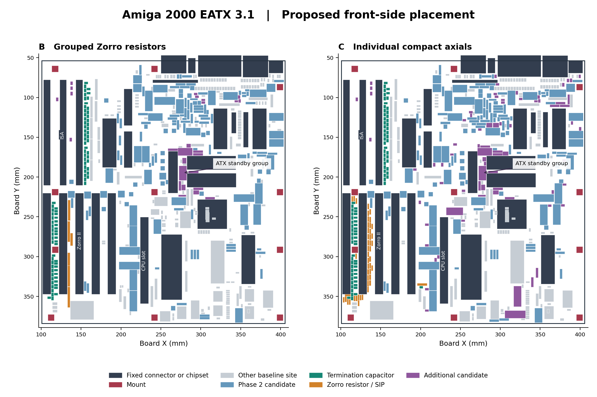
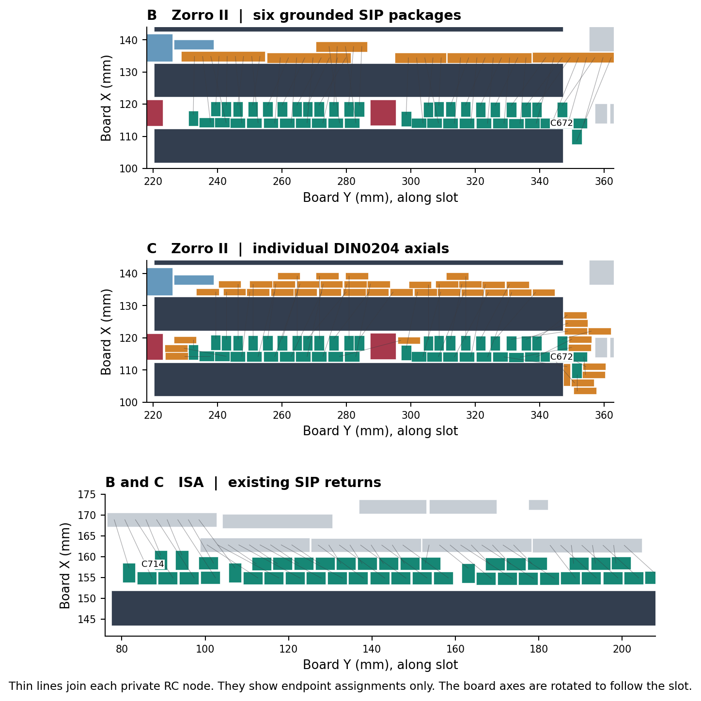

# A2000 EATX through-hole layout feasibility

**Recommendation — prototype Scenario B first.** A four-layer floorplan accommodates **338 through-hole and 206 SMD packages (62.1% THT)** while preserving the EATX mounting pattern and all connector positions. Scenario C accommodates **429 through-hole and 155 SMD packages (73.5% THT)**. C is the highest construction target supported by this study. Both percentages depend on qualifying the parts, routing the board and testing loaded hardware. The clearest reason to stop short of C would be a loss of bus or memory timing margin.

The accepted starting point is `d14bc6e`, based on production R3.1 at `dfde457`. The floorplans are coordinate studies in separate files. The KiCad project, released copper, schematic, rule settings and fabrication outputs are the production baseline. [Accepted audit](THROUGH_HOLE_CONVERSION.md) · [Per-reference A/B/C decisions](audit/layout/scenarios.csv)

The accepted B study is continued in the [Scenario B+ design](SCENARIO_B_PLUS_DESIGN.md), with the [Rev 6.2 historical comparison](ORIGINAL_A2000_REV62_COMPARISON.md) and [routed A/B/C termination coupons](coupon/README.md).

## Design matrix

| Measure | A — Conservative | B — Predominantly through-hole | C — Maximum practical |
|---|---|---|---|
| Physical population | 216 THT / 368 SMD, **37.0%** | 338 THT / 206 SMD, **62.1%** | 429 THT / 155 SMD, **73.5%** |
| Conversion of the original 519 SMD references | 151/519, 29.1% | 313/519, 60.3% | 364/519, 70.1% |
| Population and placement | Original 151 candidates. Bulk radial capacitors, small-signal parts, axial rows and DIPs. 47 candidates passed the earlier limited mutual and existing-geometry screen. | Add 46 radial Zorro capacitors and six grounded SIPs carrying their 46 resistor elements. Retain the separate grant pair. Convert 44 ISA capacitors, five ISA rail bypasses, seven serial filters and 14 underside positions. Move the standby block to the front. | Use one short horizontal DIN0204 per Zorro resistor. Convert the grant pair **at its own slot**, 31 further bypasses, seven filter/control capacitors, six series resistors, three fast logic devices and two audio JFETs. |
| Relocation and routing | Local groups still need rerouting. U600 conflicts with the CPU slot at its existing centre. The two bus termination banks keep their original routing. | Stagger capacitors alongside the last slot of each bus. Route private RC junctions to the appropriate SIP elements. Floorplan also brings 28 retained SMD bypasses to the DIP supply pins. Largest reference-centre move is about 42 mm in the standby area. | Rebuild driver-side escape around clock selection and SRAM buffers. Reorganise the discrete resistor banks and local returns. Nine retained SMD capacitors follow their load. Largest move is about 53 mm in standby timing circuitry. |
| Plane and routing effort | 745 candidate plated pads before via changes. Local return paths and existing thermals already constrain placement. | 1,054 candidate plated pads. An initial drill screen flags 59 near existing drilled features and 50 near inner tracks. | 1,248 candidate plated pads. The same screen flags 65 near existing drilled features and 54 near inner tracks. Individual ground lands increase return options and local antipad density. |
| Main electrical risk | DIP escape changes bus-buffer loading and decoupling loops. | Longer termination wiring on 90 bus branches, common-pin inductance and simultaneous switching in the new SIPs. Verify RC timing in the relocated ATX block. | Individual returns remove the new shared SIP lead. Clock pulse width, SRAM setup/hold, control-edge damping, analogue filter response and supply bounce become additional acceptance criteria. |
| Mechanical risk | Radial height by full-length cards and DIP socket access. | Side clearance between inserted cards, upright SIP and ceramic height, solder tails over the tray and access to the underside Agnus links. | Same fixed connector envelope, additional backside solder tails and more service space needed for discrete banks. Check the 5.08 mm resistor lead form and socketed-card stack in the real chassis. |
| Estimated complexity and prototype | **Moderate to high.** Local placement groups, baseline comparison and one instrumented motherboard build. | **High.** Two bus banks, standby block and many moved packages. Trial full-length bank coupons, dry-fit the chassis, then build and test an instrumented motherboard. | **Very high.** Couples bus, memory, clock and power-integrity changes. Prototype the compact bank independently, bring up fast logic in stages and allow a further board spin if timing or plane margins fail. |

Counts include 65 existing THT packages and the mutually exclusive oscillator/RTC positions. They exclude 17 etched jumpers, 11 mounting holes and two graphics. The common denominator is 584 **original component positions**. B implements 378/584 original positions in THT (64.7%), but combines 46 resistor references into six physical packages, giving 338/544 packages. A and C preserve one package per original position. Quantities for an actual assembled variant will differ. The package count changes in B have an explicit pin-to-reference crosswalk. [Scenario register](audit/layout/scenarios.csv) · [RC branch and SIP pin assignments](audit/layout/termination-paths.csv)

## Where the components fit

The floorplans use the original **304.800 × 330.200 mm centreline, 1.6 mm thickness, four copper layers, 11 mounts and existing connector pad coordinates**. Existing THT components stay at their production positions. Each moved body was placed clear of the other trial bodies and the reserved baseline footprints. The search tried rotations on a 0.5 mm local grid with the published KiCad footprint envelopes. Formed J211 and standby 10 µF capacitors use stated trial envelopes in the coordinate file. SMD bypasses moving with an IC use their existing board-space bounding box. The coordinates and package orientations can be reviewed without opening a modified board. [Placement coordinates and envelopes](audit/layout/placement.csv) · [Original mechanical guidance](userguide.md)

The study projects the reserved component footprints from both faces into the placement plane. A projected fit establishes space for the bodies in plan view. It leaves actual courtyard tolerances, creepage to cases, standoff screw diameters, card-component overhang and service-tool access to be checked. Include a fully populated bridgeboard/ISA combination, a full-length Zorro card and a CPU/video card pair in the mechanical trial. Make 1:1 prints and fit actual connector bodies before paying for a prototype. The existing ISA row discrepancy is an independent risk.

All candidate holes pass both inner layers. In1 carries GND and signals. In2 contains four power nets and routed signals. For the drill screen we used a common 1.0 mm drill, 1.8 mm land, 0.25 mm hole spacing and 0.20 mm copper clearance. Counts are per trial pad, may overlap and deliberately include existing same-net copper. A stricter PWRBIG clearance, actual land sizes, an added return via or moving a trace can change them. The screen prioritises inspection. For each bank, refill and trace the continuous return beneath the entire signal path, inspect copper between repeated antipads, verify slot-rail cross-sections at load and check thermal spokes. [Drill conflicts by part and inner net](audit/layout/drill-screen.csv) · [Source stackup](PCB.md)

## What actually limits conversion

| Primary reason | Reassessment |
|---|---|
| Existing placement | Eleven backside positions, including U9101/U9102, Q9100, D9100, six standby resistors and Agnus pull-up R109, can move to the front. Three timing capacitors can accompany the standby circuit. Their new positions require timing, switch-state and assembly-access checks. |
| Routing complexity | The 138 formerly held bus positions split into 136 original positions in B and the two separately located grant-path positions in C. Seven serial shunts and five distributed ISA rail capacitors also reopen in B. Each route has an electrical acceptance condition. |
| Electrical performance | C keeps 126 positions on electrical grounds: 60 connector feedthroughs, 29 series damping parts, 24 other bypasses, ten clock/RTC/control shunts, two regulator capacitors and the local Agnus configuration capacitor. See exact nets and exceptions by reference. |
| Suitable THT equivalent unestablished | C keeps 28 positions pending a qualified part or assembly option: 13 ferrites, four fuses, four ambiguous rectifiers, D800, U502/U504, U503, U801, X2 and Y800. Some leaded parts exist. Exact speed grade, protection curve, RTC loading, ferrite response or independent variant equivalence remains open. |
| Mechanical or thermal constraint | U9000 is the one component held primarily for combined clearance and thermal reasons. A TO-220 implementation needs measured −5 V load, a viable heatsink envelope and isolation of its live tab. At 0.25 A, dropping −12 V to −5 V dissipates about 1.75 W before regulator operating current. This example is a load assumption. |

The first-candidate column in the register explains the extra SMD retained by each scenario. A retains B's 162 and C's 51 additional opportunities plus the 155 C holds. B retains C's 51 opportunities plus those same 155. Placement or routing work alone gives no basis for a permanent SMD designation. [All 614 footprint decisions](audit/layout/scenarios.csv) · [Pad nets, including repeated shell pads](audit/baseline/pcb-pads.csv)

**Capacitors.** All scenarios include the original 31 bulk electrolytic candidates. Rail reservoirs can move within a power region if ripple current, polarity, ESR, leakage and card-height limits hold. C408 has ground on its positive terminal. Serial C310–C316 are 1 nF line shunts. They stay near the interface, with short ground returns. Standby C9103–C9105 are timing capacitors. KEMET C322C106K3R5TA provides a 10 µF radial X7R option on 5.08 mm centres. Compare capacitance at operating bias and test switch press/release, brownout and restart. A 10 µF label alone does not specify the RC delay. [Candidate leaded timing capacitor](https://www.digikey.com.au/en/products/detail/kemet/C322C106K3R5TA/6562379)

**Local decoupling.** The placement search anchored one capacitor terminal to the nearest available position beside the matched supply pin for 29 capacitor/IC pairs in B and 32 in C. Same-number association was used only when the board confirmed the rail and IC ground. The power-anchor columns identify those pairs. For C540/U540 and C541/U541 the straight-line supply pad gaps change from 6.2 and 15.4 mm to 2.5 mm each in C, with both capacitors still SMD. C503 stays on the SRAM Mcc rail. C604 has a 10.4 mm trial supply gap and deserves an early placement review. Verify the ground leg, ground via and package loop on both sides of each IC. Even 5 nH of added loop inductance at 20 mA/ns would add 100 mV of bounce. Measure the actual current edge and supply voltage at the device pins. Retain SMD at any bypass that fails this test.

**EMI and sourcing.** The 60 EMI sites have separate in/out pads and two ground lands. The shopping code resolves to an AVX W3F11A1018AT1F, 100 pF, 100 V and 300 mA. A genuine leaded three-terminal alternative family exists, but the Murata 100 pF example examined is marked end-of-life. A candidate must match supply or signal current, DCR and installed insertion loss with the real return lead. Keep the four fuses' interrupt ratings and time-current curves independent of this filter qualification. The four S1MWF/RS1MWF positions remain held: the manufacturer lists 3,000 ns and 500 ns recovery, respectively. Confirm which part the baseline is meant to reproduce. [Original filter listing](https://www.digikey.com.au/en/products/detail/kyocera-avx/W3F11A1018AT1F/1451818) · [Leaded filter lifecycle](https://eu.mouser.com/en/ProductDetail/Murata-Electronics/DSS1NB32A101Q91A) · [Rectifier comparison](https://www.diodes.com/assets/product-showcases/345690.pdf)

## Zorro II and ISA terminations

We traced both legs of **all 91 RC branches** on the production PCB. The baseline lengths follow connected track centrelines between pad centres, including pad entry segments. Vias join layers at their XY coordinate. The nearest electrically connected slot pad is an identifiable comparison point; an intervening tap can make the true unterminated stub shorter. All 46 main Zorro branches lead to **CN605**. C675/R606 on **_GBG** leads to **CN601**. All 44 ISA branches lead to **CN702**. The raw signal and junction net names are preserved. ISA RN700–RN704 already supply grounded resistor elements. RN705 is a separate pull-up network and keeps its original connections.

For every studied branch the electrical order remains **bus → 1 nF capacitor → private junction → 1 kΩ resistor → GND**. B groups the 46 Zorro resistor elements in four 10-pin, nine-element and two 6-pin, five-element bussed SIPs. Each common pin 1 goes to GND and every other connected pin goes to exactly one original private junction. Trial names ZS1–ZS6 exist only in this analysis. A future schematic package regrouping would require review of the reference crosswalk and continuity of all 46 private nodes. An isolated SIP is another electrical option if both terminals of every element are routed individually. A direct bus pull-down would destroy the DC isolation provided by the capacitor. [Bourns SIP diagrams, dimensions and power limits](https://www.bourns.com/docs/Product-Datasheets/4600x.pdf)

| Bank or package choice | Measured original route | Proposed geometry and tradeoff |
|---|---|---|
| 46 Zorro signal taps | CN605 contact to cap, 5.4–33.3 mm, median 12.8 mm | Stagger radial bodies along the end connector. Preserving the original escape to the old pad and extending to the trial pad adds 0–4.0 mm of Manhattan distance, median 3.0 mm. |
| Zorro B, six grounded SIPs | Cap to individual resistor, 2.3–2.6 mm | New private-node distances are 15.4–36.6 mm, median 22.1 mm. SIPs sit in the next aisle across the CN604 pin field. Preserve the CN605 electrical endpoint and allocate escapes between pins. A single SIP ground lead carries correlated edge current. |
| Zorro C, 46 DIN0204 axials | Same individual resistor connections | On 5.08 mm pitch the trial gives 2.5–30.5 mm, median 19.8 mm. Each resistor has its own short connection to GND. Vishay MRS16 supports 1 kΩ and the minimum formed pitch is 5 mm. Check the source tolerance, pulse duty and lead form before ordering. |
| Zorro alternative, 46 DIN0207 axials | Same individual connections | On 10.16 mm pitch the range grows to 5.0–56.5 mm, median 39.8 mm. This costs private-node length across the connector pin field with no improvement in resistor value or service access sufficient to justify the extra stub. Prefer DIN0207 for the less constrained axial rows. |
| 44 ISA branches | CN702 to cap, 5.0–7.4 mm. Cap to SIP element, 5.7–16.7 mm | Keep existing arrays. Stagger radial bodies alongside CN702. The signal-side allowance is 0–3.5 mm. New private-node distances are 4.8–23.0 mm. Keep each capacitor attached to its original slot pin and its original SIP element. |
| Single Zorro grant branch | CN601 to C675, 14.4 mm. C675 to R606, 2.55 mm | A and B preserve both SMT sites. C keeps the capacitor signal pad at the old location and trials a separate axial R606 with an 8.6 mm private segment. Test bus-grant sequencing independently. |

The proposed distances are pin-to-pin Manhattan estimates and assume clear corridors. Orthogonal escape, obstacles, plane boundaries and layer transitions can change the routed lengths. In particular the traces have to pass real plated slot pins. As a countercheck, allocating SIPs the closest space before placing capacitors pushed the median signal-tap extension to 20 mm. Giving the **capacitor signal pad** first choice reduced it to 3 mm. Use that placement order. [Every branch, four layouts and SIP pin crosswalk](audit/layout/termination-paths.csv) · [Axial dimensions](https://www.vishay.com/docs/28724/mrs16m25.pdf)

### Signal settling and ringing

The original signal and private-junction nets use 0.25 mm external tracks. Their actual impedances depend on the return layer, plane splits, copper pours, stackup and attached cards. The 1 kΩ/1 nF branch has a 1 µs RC time constant. At a fast edge a lone 1 kΩ load on a 70 Ω line has a reflection coefficient of about +0.87. The path from the capacitor to the resistor is therefore part of the high-frequency stub. At an assumed 160 mm/ns, an additional 34 mm gives roughly **0.43 ns round-trip**. A 2 ns edge can resolve that change even on a bus operating near 7 MHz. Under nine simultaneous 5 mA changes in 2 ns, an assumed 3 nH SIP common lead would develop approximately 68 mV. That simultaneous-switching contribution needs a separate measurement.

We modelled one driven trunk and one slot receiver with a branch transmission line on **each side** of the series capacitor. The ideal 0–5 V source drives a 150 mm trunk. The sweep uses 55/70/95 Ω line impedances, 160 mm/ns velocity, 2/8 ns edges, 25/50 Ω source resistance and 15/80 pF effective load in five stated combinations. Total lumped series inductance is 2 nH for the surface-mounted reference and 10 nH for the through-hole trial. Representative nets include the longest combined estimated paths in B and C. These are sensitivity assumptions. The simulation omits driver clamps, actual card stubs, common-return coupling, connector models, falling-edge asymmetry and rail movement. Overshoot beyond the rails makes the limits of the ideal model particularly visible. [Executable model](audit/layout/edge_sensitivity.py) · [Results and threshold crossings](audit/layout/edge-sensitivity.csv) · [TI transmission-line guidance](https://www.ti.com/lit/an/scaa082a/scaa082a.pdf)

| 2 ns, 25 Ω driver, 15 pF, 70 Ω line | Stored route | B | C compact |
|---|---:|---:|---:|
| CN605 BD4 / C672 peak voltage | 6.486 V | 6.457 V | 6.483 V |
| CN605 BD4 time to stay within ±5% of 5 V for the balance of the first 100 ns | 11.10 ns | 11.83 ns | 11.20 ns |
| CN702 / C714 settling by the same measure | 10.78 ns | 11.03 ns | 11.03 ns |
| CN601 _GBG / C675 settling by the same measure | 10.75 ns | Original topology | 10.88 ns |

Here B reduces peak voltage slightly yet delays settling on BD4 by about 0.73 ns. Port and load choices also change which reflection last leaves the ±5% band. **There is no measured receiver timing margin in this audit against which to accept that delay.** Before adopting either bank, obtain stackup-specific impedance, extract each routed branch including vias and connector entry, and model the complete loaded trunk with actual driver/receiver data. Probe near and far receivers on the working Rev 3.1 board and prototype with identical low-capacitance probes. Exercise empty/full slots, representative long cards, simultaneous switching, bridgeboard ISA cycles, CPU/Zorro DMA ownership changes and both edge polarities. Accept only if absolute ratings, clamping limits, noise margins, single valid threshold crossings and receiver setup/hold all hold across supply, load and temperature. Keep the original SMD bank on any failing bus. [Commodore expansion-bus electrical guidance](https://www.theflatnet.de/pub/cbm/amiga/AmigaDevDocs/hard_k.html)

## Logic, memory and analogue equivalence

| Devices | Package decision and electrical checks |
|---|---|
| 74HCT00/04/08/32/74/138/157/245/373, 74AHCT244/245, 74LS38/148 in A | Use the exact-family PDIP candidates listed per reference. Preserve 5 V input thresholds, output current at the specified VOH/VOL, polarities, direction, OE and high-impedance leakage. For U600–U605, HCT245 specifies VIH ≥2.0 V and VIL ≤0.8 V at 4.5–5.5 V. Compare propagation and both output enable/disable limits at the actual bus load. U203 needs the LS38 open-collector output and its pull-up rise time. Check each DIP pin, including unused gates, against physical pad nets. [HCT245](https://www.ti.com/lit/ds/symlink/sn74hct245.pdf) · [AHCT245 PDIP](https://www.ti.com/product/SN74AHCT245/part-details/SN74AHCT245N) · [LS38](https://www.ti.com/lit/ds/symlink/sn74ls38.pdf) |
| U9101 / U9102 | B moves the underside HCT14/HCT74 to front-side SN74HCT14N and SN74HCT74N. Preserve Schmitt hysteresis, input ramp limits, asynchronous set/clear and rail sequencing on +5VSB. Test power-on reset and switch bounce with the actual RC components. [HCT14](https://www.ti.com/lit/ds/symlink/sn74hct14.pdf) · [HCT74N](https://www.ti.com/product/SN74HCT74/part-details/SN74HCT74N) |
| U109 / U540 / U541 | C trials SN74F258N for the inverting, tri-state clock mux and SN74AHCT244N for the memory buffers. Preserve the exact families, local damping and bypass. Check high/low pulse widths at Agnus, XCLK selection, loaded select and enable skew, SRAM write pulse width and address/data setup and hold at both temperature extremes. [F258](https://www.ti.com/lit/ds/symlink/sn74f258.pdf) · [AHCT244](https://www.ti.com/lit/ds/symlink/sn74ahct244.pdf) |
| U502 / U504 / U503 | Keep the FCT registers and 5 V wide SRAM in all cases. The BOM orders CY74FCT821ATSOC. TI lists a 10 ns A-grade SOIC and a historical 7.5 ns B-grade DIP. A faster maximum delay leaves minimum delay, hold and bus handoff unresolved. No qualified like-for-like leaded 1M × 16 SRAM was identified. Respect J503 and both byte lanes. [FCT ordering and timing](https://www.ti.com/lit/ds/symlink/cy74fct821t.pdf) · [Baseline shopping list](BOM/A2000EATX-REV31-ShoppingList.csv) |
| U204 / U805 / U304 / U305 / XU1, Q200 / Q201 | A includes DIP LF347, LM339, RS-232 driver/receiver and a TO-92 DS1813 of the original −5 grade. Check bipolar rails, common-mode range, reset threshold, leakage and pin functions. C reopens Q200/Q201 because onsemi documents J211 and MMBFJ211 together. Confirm ordered formed leads, gate cutoff, drain current spread, and both audio responses with the filter switched in and out. [Original part-by-part candidates](audit/component-plan.csv) · [J211 family data](https://www.onsemi.com/download/data-sheet/pdf/mmbfj211-d.pdf) |

Some upstream entries identify only a generic family. Final equivalence requires the fitted SMD manufacturer's suffix, operating grade, pin drawing and worst-case loads. Each scenario preserves the original CPU/chipset, addressing, interrupts, DMA and expansion architecture. Any family substitution or correction of an inherited circuit is a separate engineering decision.

## Inherited ERC, DRC and mechanical issues

The 24 ERC and 85 stored-fill DRC errors were investigated independently of the conversion study. The item register records each finding and follow-up. The accepted 1,182 ERC warnings, 202 DRC warnings and 17 parity warnings remain visible in the original reports. [Individual error triage](audit/layout/baseline-error-triage.csv) · [Baseline reports](audit/baseline)

| Finding | What the evidence establishes and how to resolve it |
|---|---|
| Eight output-to-output ERC errors | Seven involve CPU and Gary A17–A23. Trace direction and bus ownership against Gary/68000 documentation. One is the shared X1/X2 output with exclusive oscillator populations. Verify build variants and pin-1 enable before disposition. |
| Seven undriven inputs | JA11–JA14 centre pins and U101 pins 19, 23 and 25. Check every supported Agnus strap against the decoder output that must drive that net. An open solder-link state can change the result. |
| Nine undriven power pins | Physical feed paths include J503 to Mcc, EMI229 to Denise pin 19, D800 to CLKVCC, passive drops/filters to the audio/video rails and an analogue reference divider. Confirm polarity and loaded local voltage. ERC's source-pin classification cannot establish physical continuity or load capacity. |
| 85 incomplete thermal reliefs | 71 report one effective spoke where two are required. Fourteen report spokes connected to an isolated island. Distribution is 51 front GND, 29 back GND, four internal GND and one internal +5 V. A KiCad 10.0.8 **in-memory refill on a disposable copy** left 82 errors, 202 warnings, zero unconnected items and 17 parity warnings. The three findings that cleared were front GND on CN603 pad 3, C804 pad 2 and U500 pad 12. The baseline of record stays at 85. Check copper necks and return current even where a refill clears a marker. |
| ISA and LF347 | CN700/701/702 measure 4.8514 mm between A1/B1 rows against the cited 5.08 mm part drawing. Preserve the slot datums and obtain a connector fit coupon. U204's B/D symbols mislabel the input signs. Physical pins 5/12 are non-inverting and 6/13 are inverting. Preserve the correct physical wiring through any DIP trial. Track a symbol-only correction separately. [ISA issue](https://github.com/jasonsbeer/Amiga-2000-EATX/issues/45) · [LF347 issue](https://github.com/jasonsbeer/Amiga-2000-EATX/issues/41) |

For all future checks retain the **3,631 schematic pin/net assignments on 858 nets** and compare the **3,726 individual PCB pads**, including duplicate numbers. The 14 pad-0 shell lands of CN200, CN202, CN300 and CN305 must still be physically grounded. Carry through the 20 unassigned PCB pad keys and verify each mapped transistor terminal and proposed SIP element against the original net partition. Compare both connectivity and geometry for connectors, ground contacts, outline, holes and card slots. [Original pin-level baseline](audit/baseline/pcb-pads.csv)

## Recommended implementation sequence

1. **Qualify the parts and baseline.** Freeze the actual Agnus, RTC, oscillator, SRAM and ISA population used for comparison. Identify unknown fitted component specifications. Record working baseline supply droop, slot waveforms, audio response, reset and memory timing before altering a prototype.
2. **Trial the low-risk assembly groups.** Start with radial bulk capacitors and discrete bias/analogue resistors. Check lead form, drill fit, polarity, thermal loading and service access. Group DIPs with their bypasses. Dry-fit the rear I/O, full-length cards and brackets.
3. **Compare the expansion banks on representative coupons.** Reproduce the stack, connector, original SMD branch and candidate SIP/compact axial returns. Include adjacent active signals and the H7 interruption. Prioritise BD4, the longest-baseline branches and the separate _GBG net. Measure settling, clamp current and common-ground bounce before assigning the motherboard banks.
4. **Implement B in reviewable groups after approval.** Route from the actual bus tap outwards, keep the ground reference continuous, refill, run parity/ERC/DRC and compare against the stored baseline after each group. Then test a populated prototype against the original. If the six new SIPs fail and the radial Zorro capacitors pass, retaining the 46 individual SMD resistors leaves **332/584 (56.8%)**. Qualifying 19 more of C's non-bank sites would reach **351/584 (60.1%)** without a shared SIP return.
5. **Advance selected C groups on evidence.** The compact individual resistors remove the new common lead. Gate the fast DIP devices separately on clock and RAM timing margins, and gate the extra local ceramics on package-pin voltage. Retaining both components of all 46 CN605 terminations at their baseline while implementing the remainder of C would yield **337/584 (57.7%)**. Keep a verified lower percentage wherever a candidate fails. Release to fabrication only after a separately reviewed routed design, prototype and final baseline comparison.
