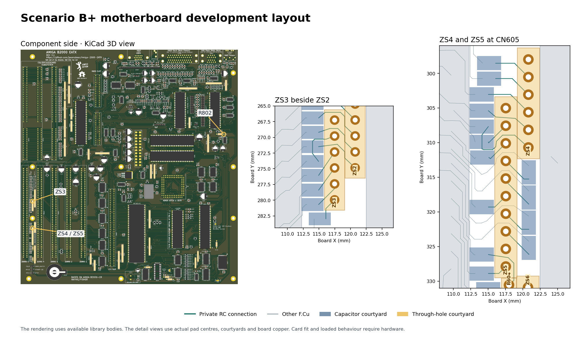

# Scenario B+ conversion review, November 2026

The development motherboard advances from 73 through-hole and 496 surface-mount packages at `fa32310` to **77 through-hole and 477 surface-mount packages** at `52200ba`. The installed fraction is **77/554 (13.9%)**. The Scenario B+ proposal targets approximately 62.6%. Five SIP packages now carry **35 of 44** Zorro termination elements. Nine discrete resistors remain at ZS1.

| Accepted change | Board revision | Physical packages after change (THT / SMD) | Electrical change checked |
|---|---|---:|---|
| [R802, comparator bias](../r802/conversion.csv) | [86c9236](https://github.com/GregWinfield/Amiga-2000-EATX/commit/86c9236) | 74 / 495 | 10 kΩ DIN0207 axial, input copper retained, direct +5 V barrel replaces one supply via. |
| [ZS3, address lines](../zorro-zs3/README.md) | [5195fc4](https://github.com/GregWinfield/Amiga-2000-EATX/commit/5195fc4) | 75 / 490 | Five 1 kΩ elements. Rechecked the four neighbouring ZS2 returns affected by the capacitor move. |
| [ZS4, end-slot termination](../zorro-zs4/README.md) | [476f802](https://github.com/GregWinfield/Amiga-2000-EATX/commit/476f802) | 76 / 485 | Five 1 kΩ elements. Fourteen bottom-layer signals use local escapes. |
| [ZS5, data and strobes](../zorro-zs5/README.md) | [52200ba](https://github.com/GregWinfield/Amiga-2000-EATX/commit/52200ba) | 77 / 477 | Eight 1 kΩ elements, separate capacitor junctions, pin 1 grounded and pin 9 unused. E7M and R604 retain their accepted geometry. |

Each batch has a raw KiCad report archive and a same-version control. The branch manifests identify both the former resistor and its new SIP pin. The [motherboard BOM](../../../BOM/SCENARIO_B_PLUS.csv) records the installed design. Counts reflect physical packages, including each populated SIP once.

## Electrical and mechanical checks

The final KiCad 10.0.8 comparison gives zero new DRC findings, zero open connections and zero unintended logical pin-map differences. The refilled board retains 73 DRC errors, 202 DRC warnings and 17 schematic-parity warnings. ERC retains 24 errors and 1,182 warnings. Four inherited ERC findings report different representative objects. The 304.8 × 330.2 mm EATX outline, four-layer stack and all 54 checked mechanical references, including the 11 mounting locations and five expansion socket centres, match the control. The three new SIP banks preserve the 1,211 vias on the R802 board. [Final verification and plane checks](../zorro-zs5/verification.json) · [Native ERC, DRC and connectivity output](../zorro-zs5/kicad-reports.zip)

## Conversions held for engineering review

- **ZS1** retains nine discrete 1 kΩ resistors. All nine branches routed in the trial, but minimum aggregate In2 copper fell from 3.050 to 0.525 mm on −5 V, 7.550 to 1.400 mm on +12 V and 5.825 to 1.300 mm on −12 V. The _OWN route also lost local reference coverage. Approving a different location or a rail bypass requires a current and return-path review. [Trial, alternative positions and reproducible patches](../zs1-evaluation/README.md)
- **C224** retains its 4.7 µF surface-mount capacitor. The routed radial candidate passed CAD comparison. Its 11 mm can exceeds the generic 7 mm model height, and the original part's broadband impedance is unspecified. Check fitted height, impedance and audio-reference response before accepting the radial part. [Trial, component specification and reproducible patches](../c224-evaluation/README.md)

## Outstanding validation

The routed geometry has development-layout approval. ZS5 adds 8.35–9.36 mm on four signal-side taps. Measure receiver overshoot, settling, timing and common-ground bounce with representative near and far cards. The closest ZS5/ZS6 courtyard gap is 0.080 mm, with 0.70 mm nominal clearance between centred maximum-width bodies. Check insertion, withdrawal, solder access and fit on actual parts. Qualification also requires the PCB supplier's written registration, line/space, mask and finished-bore guarantees and a connector witness. The SDS1104X-U measurement-plan revision remains pending. [Risk register](../../../SCENARIO_B_PLUS_IMPLEMENTATION.md) · [Per-net lengths](../zorro-zs5/routing.csv) · [Coupon measurement plan](../../../coupon/MEASUREMENT_PLAN.md)
