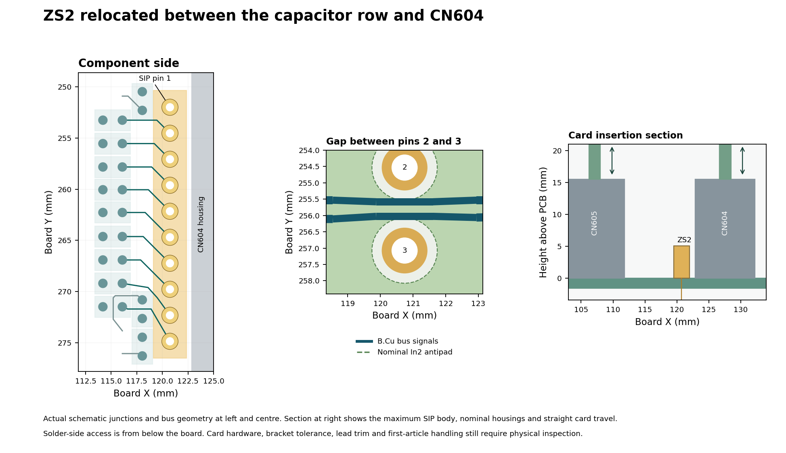

# Relocated ZS2 termination bank

The capacitor-side placement passes the development-board electrical, layout and nominal mechanical checks against `1f461ed`. ZS2 pin 1 is at (120.740, 251.995) mm, 13.6552 mm west and 4.913 mm north of the rejected position. R602A1–R602I1 become the nine independent branches of a Bourns 4610X-101-102LF. Pin 1 is the common ground and pins 2–10 each terminate a different capacitor junction through 1 kΩ. Every original capacitor and its bus-side copper stayed in place. R601I1, R603A1 and R603B1 rotated in the adjacent strip. Their rear service legends are readable from the solder side. [Element, signal and connector mapping](conversion.csv) · [Bourns circuit 101 and package drawing](https://www.bourns.com/docs/Product-Datasheets/4600x.pdf)

| Check | Rejected position at 7f82c5c | Implemented position |
|---|---|---|
| Capacitor-side paths | Nine open on the review PCB | Nine independent 0.25 mm F.Cu routes, 5.178–6.506 mm, versus 2.316–2.380 mm for the discrete resistors. No inter-layer transitions. |
| Standard 1.60 mm lands | Two 0.20 mm traces and three 0.20 mm spaces require 1.00 mm in a 0.94 mm gap | First routed with all 1.60 mm lands and the existing bottom routes. Zero opens. KiCad identified 28 bottom clearance violations, the worst at BA3/pin 1 (0.0481 mm). Seven paired gaps preclude using these lands for a local escape at board rules. |
| Installed padstack | 1.40 mm B.Cu, 1.60 mm F.Cu and both inner layers | Same reviewed padstack, 0.80 mm finished bore, 2.54 mm pitch, square pin 1. Rear and front mask openings are 1.50 and 1.70 mm respectively. |
| Bus | 17 local passes, 0.01749–0.17434 mm added per net. BA8 shorted outside the bank. | 18 local B.Cu passes including two end clearances. Fourteen of the previous 17 need local changes, and BA16, _BEER and _VPA retain their entire original routes. BA2, BA3, BA7 and BA8 join the affected set. Each change stays in a 4.40 mm window, uses 0.220 mm copper and adds 0.00181–0.00359 mm to its net. |
| Clearances | 0.22924 mm between modified bus traces. 13 short reports involving five nets. | 0.226 mm between modified traces, 0.249 mm to another bus trace, 0.237 mm to a bottom SIP land including BA8, and 0.187 mm to the rear mask opening. All four front control trunks and both grant-related trunks retain their copper. |
| Protected geometry and vias | Review layout only | Every one of the 1,212 via objects compares equal. The EATX outline, 1.60 mm four-layer stack, 11 mounting centres, 500 Zorro solder tails and all connector datums compare equal. |

The copper-to-copper distances from edited front tracks and ZS2 lands to _EBG3, _EBR3, _BAS, _BUDS, _BLDS and READ are at least 5.945, 6.420, 8.645, 8.195, 7.746 and 7.320 mm respectively. These six measurements are to the existing **tracks**. Full-board DRC separately covers pads, vias, pours and the rest of the design. [Clearance measurements](clearances.json) · [Per-net comparison including the rejected geometry](bus-comparison.csv) · [Private branches and changed ground copper](routing.csv)

## Return paths and electrical verification

The original plane settings left gaps in the +5 V reference under each local B.Cu pass, up to 2.249 mm along BA3. ZS2 has two local same-net fills using the existing socket-region rule of 0.20 mm clearance and minimum thickness. These cover x = 118.7–122.8 and y = 249.7–277.2 mm on In1 GND and In2 +5 V. They have no intersection with any auxiliary-rail pour. Both refill as one connected polygon. Pin 1 has four sampled In1 ground spokes and a 0.381 mm F.Cu link to CN604.25. R603B1 uses 45° thermal spokes on its ground pad. The nine private F.Cu nodes approach over ground up to their own through-hole antipads, with approximately 1.00 mm of unbacked centreline immediately at each termination.

Across each of the nine pin gaps, the sampled +5 V bridge is about 0.53 mm wide on the pin-centre line. Sampling at ≤0.015 mm intervals on each modified bus centreline found zero uncovered length. The widest paired copper envelope spans 0.666 mm. The trace edges extend beyond the narrowest plane bridge and the nominal centreline-to-bridge-edge allowance is only about 0.04 mm per side. Layer registration and return-current spreading still affect actual waveforms. Request outer-to-In2 overlay data, inspect the witness microsection and measure the loaded receivers and common-ground bounce. The sampled geometry establishes continuity only.

After final zone refill, KiCad 10.0.8 reports zero opens. All 275 DRC findings (73 errors, 202 warnings) and the 17 schematic-parity findings match the baseline by type, object description and location. ERC retains 24 errors and 1,182 warnings. Seven inherited conditions cited alternative representative objects. The complete schematic pin maps and physical pad-net multisets compare equal after mapping nine old common pins to ZS2.1. Schematic assignments go from 3,625 to 3,617 and board pad records from 3,720 to 3,712. No rule exclusions were added. [Full comparison and plane samples](verification.json) · [KiCad reports and both schematic netlists](kicad-reports.zip)

## Assembly envelope and process limits

The maximum Bourns body is 25.35 × 2.49 × 5.08 mm. With the lead row centred and the SIP seated, its nominal side clearance to the CN604 housing is 0.901 mm and to the nearest capacitor courtyard is 2.609 mm. The SIP courtyard clears CN604 by 0.121 mm and each of the three relocated 0805 courtyards by 0.100 mm. The complete solder-side row is accessible before tray installation. The nearest CN604 tail is about 2.93 mm away measured between land edges. Fit the adjacent small resistors before the SIP and allow access from below for SIP desoldering. A nominal 1.60 mm board and a seated lead length of 3.0–3.8 mm leave 1.4–2.2 mm below the board before trimming. Check lead trim against the actual tray. [Bourns dimensional drawing](https://www.bourns.com/docs/Product-Datasheets/4600x.pdf) · [TE socket and customer drawing](https://www.te.com/en/product-5645235-3.html)

A straight insertion or withdrawal of 1.78 mm mating-card stock leaves 4.686 mm from its near face to the SIP at CN604 and 11.465 mm at CN605. The seated SIP is 10.42 mm below the nominal 15.5 mm socket top. An added 1 mm SIP standoff would reduce that last margin to 9.42 mm. These checks cover the straight finger path and card components above the housing top. Card-specific low overhangs, bracket tilt, solder tails, lead-form tolerances and repeated removal require a populated first article. Retain the TE footprint's existing gauge and fabrication gates. [TE part data](https://www.te.com/en/product-5645235-3.html) · [Commodore expansion-card outline, Appendix A-4](https://amiga.net.au/files/Tech_Amiga/Commodore_A500-A2000_Technical_Reference_Manual.pdf)

Nominal outer annuli are 0.300 mm on B.Cu and 0.400 mm on F.Cu. With 0.040 mm diametric land loss, 0.060 mm radial copper-to-drill offset and a maximum 0.85 mm finished hole, the calculated residuals are 0.195 and 0.295 mm. A 0.94 mm maximum preplate tool gives 0.150 mm bottom and 0.250 mm inner copper to the drilled wall. The circular bottom solderable area is 1.037 mm², 31.25% below the original round land. The largest lead diagonal is about 0.673 mm, leaving 0.077 mm diametral clearance at a 0.75 mm minimum bore. Gauge all ten pins together and inspect common-pin wetting, barrel fill, joint adhesion and rework on a witness.

With a guaranteed trace width of 0.220 ±0.020 mm and land diameter tolerance of ±0.040 mm, the local pair and land spaces calculate to at least 0.206 and 0.207 mm before further same-layer positional error. Require guaranteed finished width and spacing of at least 0.200 mm, residual rings, board-to-mask registration and inner reference overlay on the quoted four-layer build. The fabricator's published ±20% track-width and general PTH tolerances do not guarantee that combined envelope. The SIP hole is a soldered-lead bore and requires its own tool/finish agreement. Written CAM concurrence, physical fit and electrical measurements remain release gates. [Fabricator capabilities](https://jlcpcb.com/capabilities/pcb-capabilities) · [Comparison with the earlier tolerance stack](../zs2-evaluation/README.md)

After this group the board contains 72 THT and 497 SMD packages in 569 design positions (12.7% THT). Two installed SIPs account for 17 of the 44 planned Zorro resistor elements.
