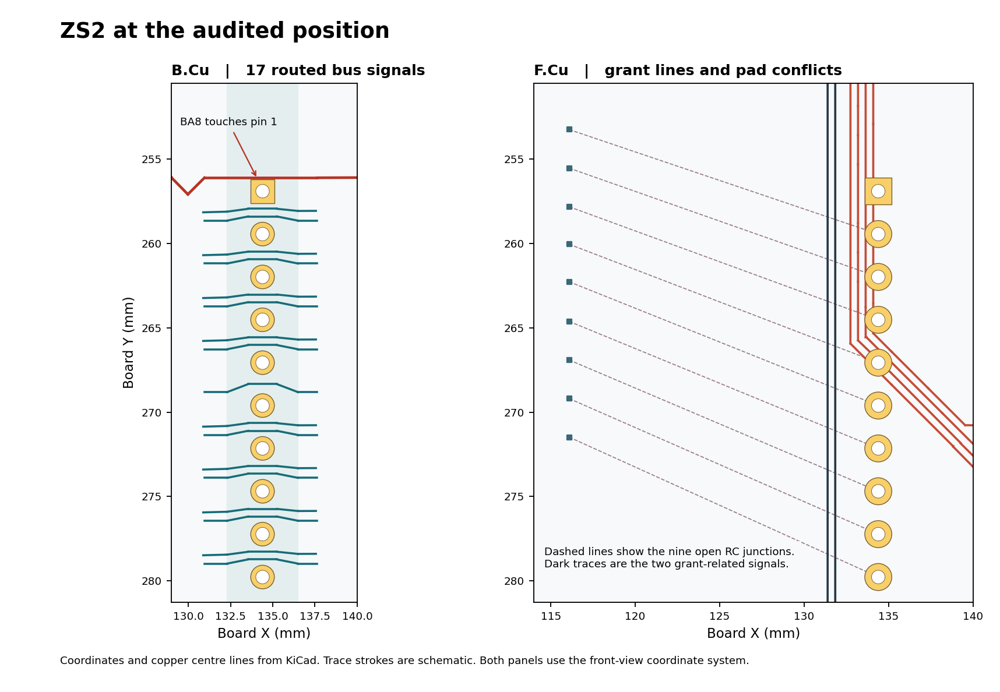

# ZS2 at the audited CN604-side position

**Disposition: reject this placement for the implementation board.** The layer-specific padstack accommodates all 17 specified B.Cu passes. A separate B.Cu trace, BA8, shorts to the square ground pad just outside the nine gaps. Four F.Cu control signals intersect the unchanged front lands, and the nine capacitor-to-resistor branches are open. The motherboard keeps the nine original individual resistors at this station.

## Layout and electrical evidence

The trial is based on motherboard commit `efa27f47352d38860bb254f2b5294010321e54c2`. Pin 1 sits at (134.3952, 256.9080) mm, with pin 10 at (134.3952, 279.7680). Each native KiCad 10 front/inner/back padstack has 1.60 mm F.Cu, In1.Cu and In2.Cu lands, a 1.40 mm B.Cu land and a 0.80 mm nominal finished bore. Pitch is 2.54 mm. Pin 1 retains the square identifier and GND common. Pins 2–10 connect to the nine independent capacitor junctions in the schematic. The 10-pin Bourns 101 circuit supplies nine bussed 1 kΩ elements. [Bourns drawing and circuit](https://www.bourns.com/docs/Product-Datasheets/4600x.pdf)

| Check | Final trial result |
|---|---|
| 17 affected bus nets | All 17 connected through the bank on B.Cu, eight paired gaps and one single gap. The three-segment replacement per net spans x = 132.2952–136.4952 mm. |
| Width and copper spacing | 0.220 mm local width. The minimum between two modified traces is 0.22924 mm on the BFC0/BA10 approach. Minimum ZS2 bottom-land to any of the 17 traces is 0.23333 mm. |
| Length and topology | Total routed copper for individual signals increases 0.01749–0.17434 mm. Maximum difference between added lengths is 0.15685 mm. Same layer, same ends, no added signal branches, zero via-count changes on every net. These are copper lengths, without propagation-delay or waveform measurements. |
| Bottom mask | KiCad mask export shows a 1.50 mm opening on the 1.40 mm land and 1.70 mm on the 1.60 mm front land. Nominal inter-pad mask webs are 1.04 and 0.84 mm. The minimum bottom aperture-to-trace margin for the 17 passes is 0.18333 mm. BA8 separately intersects the pin-one aperture. |
| Other B.Cu copper | BA8 crosses the corner region of pin 1. KiCad reports one short and one rear mask bridge. BA8 crosses outside the pin-one to pin-ten centre span and was outside the set of 17. |
| F.Cu and private junctions | Twelve short reports involve _BUDS, _BAS, _BLDS and READ. A further _BAS approach measures 0.0991 mm against 0.20 mm required. Sixteen front mask bridge reports accompany these conflicts. The two grant-related trunks _EBG3 and _EBR3 run between the capacitor row and ZS2. All nine private branches remain open in this review board. |
| Full-board checks | KiCad 10.0.8 ERC retains 24 errors and 1,182 warnings. Five existing warnings cite different objects on the same named condition. After copper refill, DRC adds 31 errors and one silk warning to the 73 errors and 202 warnings in the control. Nine open connections are reported separately. The 17 inherited schematic-parity findings compare equal. |
| Named connectivity and mechanics | Expanding the nine discrete resistor ground pins into one shared pin accounts for the change from 3,625 to 3,617 schematic nodes and 3,720 to 3,712 board pads. Every resulting pin/net matches. No connector, mounting datum, outline or stack change. The physical shorts and opens above independently fail the layout. |

The complete lane-by-lane measurements, mapped nets, failing pads, coordinates, before/after zone areas and raw KiCad results are archived. To inspect the exact evaluation, extract the layout archive at the root of a **separate checkout of the cited baseline**. It overlays the trial PCB, Zorro schematic sheet and project footprint. [Lane lengths](lanes.csv) · [All changed net lengths](routing.csv) · [Verification and individual findings](verification.json) · [KiCad reports and netlists](kicad-reports.zip) · [Native review layout](layout-review.zip)

## Manufacturing and assembly

The nominal finished-hole annuli are 0.300 mm on B.Cu and 0.400 mm on F.Cu. Use minimum remaining ring = (minimum etched land diameter − maximum hole diameter) / 2 − maximum relative radial eccentricity. Use actual preplate drill diameter for inner copper and ask for the minimum remaining copper at the drilled wall on external layers as well. The finished-hole annulus includes barrel plating.

| Illustrative tolerance stack, mm | B.Cu | F.Cu / inner |
|---|---:|---:|
| 0.85 max finished bore, 0.04 diameter etch loss, 0.060 radial offset | 0.195 | 0.295 front |
| 0.93 max finished bore, same etch and offset | 0.155 | 0.255 front |
| 0.95 max preplate drill, same etch and offset | 0.145 to drilled wall | 0.245 to drilled wall |
| 0.93 max finished bore, 0.04 etch loss, illustrative ±0.075 on both axes (0.1061 radial) | 0.109 | 0.209 front |

JLCPCB lists a general PTH tolerance of +0.13/−0.08 mm and a distinct multilayer ENIG circular press-fit option at ±0.05 mm. The SIP uses soldered leads. Obtain written agreement on any tighter bore for this application, actual preplate tool, per-layer copper-to-drill registration, land etch tolerance and minimum residual ring. The published hole-position allowance alone does not establish relative copper registration. The final example falls below the 0.125 mm project floor. A 0.95 mm drill under the illustrative etch/offset stack leaves only 0.145 mm bottom copper to the drilled wall. If the supplier requires 0.150 mm there, the maximum allowed tool under that stack is 0.940 mm. [Fabricator capabilities](https://jlcpcb.com/capabilities/pcb-capabilities)

The vendor's general ±20% width tolerance permits 0.176–0.264 mm on a 0.220 mm nominal track. For a guaranteed 0.200 mm finished width and spacing, an illustrative ±0.020 mm width and ±0.040 mm land diameter give 0.20924 mm for the worst track pair and 0.20333 mm for the worst pad/track gap, before any further relative placement error. The latter has only 0.00333 mm of unallocated margin. Ask the fabricator to guarantee finished widths, local spaces, plated bore, drill-to-track and mask registration on the same stackup. Provide the actual mask apertures and verify track coverage. The nominal bore-to-nearest routed trace is at least 0.53333 mm for the 17-lane set. BA8 independently fails that layout. [Fabricator process limits](https://jlcpcb.com/capabilities/pcb-capabilities)

The reduced bottom land offers 1.037 mm² of exposed copper outside the nominal hole on each circular pin, down from 1.508 mm² (31.25% less). The maximum rectangular lead dimensions in the Bourns drawing give a diagonal of approximately 0.673 mm. A minimum 0.75 mm bore leaves about 0.077 mm diametral clearance, or about 0.047 mm for the 0.72 mm standard minimum bore. Ten-pin insertion also depends on pitch, lead forming and hole positions. Gauge an actual network without force. Inspect bottom fillet, top-side wetting and barrel fill on the common and a signal pin, then check adhesion and rework tolerance on a process witness. Smaller soldering-side lands reduce the available fillet and repair area. No supplier acceptance or physical results are recorded. [Package dimensions](https://www.bourns.com/docs/Product-Datasheets/4600x.pdf)

## Alternative routing decisions

| Alternative | Effect on routing and return current | Decision |
|---|---|---|
| Option 2, migrate selected full interslot signals to F.Cu | Can relieve bottom escape density. The adjoining reference changes from In2 +5 V to In1 GND. Existing through-hole endpoints could avoid added signal vias only where both ends and the entire front corridor are available. Four controls already strike front lands and two more trunks separate the RC nodes. The nine private joins and the BA8/pin-one conflict each need their own resolution. | Higher risk at this station. Require endpoint-to-endpoint routes, comparison of lengths, available plane return between +5 V and GND at transitions, and loaded timing margin. No routed alternative or measured timing is claimed. |
| Option 3, fan out around one or both ends on B.Cu | Retains the adjoining +5 V plane and could keep original layer transitions. The cost depends strongly on the chosen lane. For example, at y = 268.813 mm a route around the pin-ten end must cross x = 134.3952 at y ≥ 280.778 mm (0.70 land radius + 0.20 clearance + 0.11 trace radius). With equal-height endpoints 4.2 mm apart, even an obstacle-free path adds about 20.1 mm over a straight crossing. This is an illustrative lower bound for a central lane, not a chosen route. End-near lanes incur less. The front collisions remain. | Prefer this over changing reference layers if a bottom escape alone needs relief. Here the 17 lanes already fit. Further bus length buys little until placement and front access are resolved. |

**Engineering review requested:** evaluate moving ZS2 to the capacitor side of both grant-related trunks before authorizing either interslot reroute. This changes the audited SIP location. A placement trial must account for the adjacent connector and card envelope, BA8, nine actual private routes and the common-ground return. The current station stays on discrete termination until a complete layout passes.
