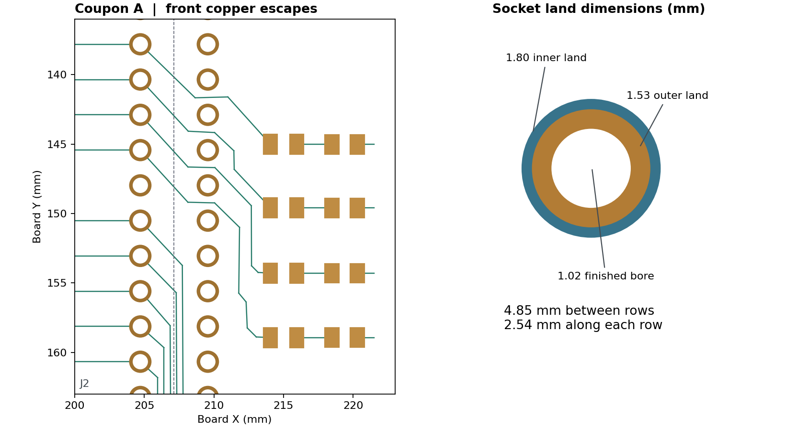
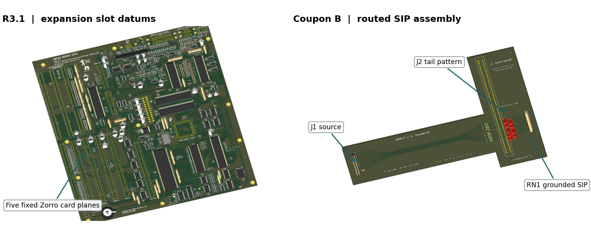

# Termination coupon fabrication readiness

**Layout approved provisionally. Manufacturing release is on hold.** All three four-layer review archives contain the revised J2 pattern. Supplier acceptance, inspection of a genuine -3 sample and representative measurements are open. The user's SDS1104X-U measurement-plan revision will be reviewed separately.

| Evidence | Result for each of A, B and C |
|---|---|
| Schematic ERC, filled-board DRC, schematic parity | 0 findings, 0 unrouted |
| Schematic pins vs physical pad-net assignment | Exact match for every numbered pad |
| RC topology | Nine distinct two-pin private junctions per board. A uses individual SMD returns, B uses separate SIP elements with common pin 1 grounded, C uses individual axial returns |
| Front, In1, In2, back artwork | 100 correctly sized socket flashes on **each** copper layer, including electrically unused contacts |
| Metric Excellon | 100 hits at 1.02 mm matched to the 100 expected socket positions within file precision |
| Control geometry | A's largest change in socket-to-capacitor length versus R3.1 is 0.074 mm on BD2. All nine private branches agree within 0.001 mm. Source-to-socket lengths are matched across A/B/C |
| Bench and manufacturing data | Supplier acceptance, first article, fitted resistance matrix, impedance and receiver waveforms pending |

[ERC/DRC reports](checks) · [Independent KiCad pin and geometry checks](verify.py) · [Review archive checks](check_review_archives.py) · [Per-lane copper lengths](lanes.csv) · [TE and JLCPCB process requirements](CONNECTOR_RESOLUTION.md)

The oblique views use available KiCad component models. J2's plated pattern is visible. Verify the actual socket body, board seating, retention posts and bracket against a physical sample.

## Physical validation and equipment

| Gate | Equipment and record |
|---|---|
| Before requesting a build | Genuine TE 5645235-3 with lot label, dimensioned 1:1 print checked against a rule in both axes, optical comparator or calibrated vision CMM for two-row spacing, end span, retention pattern and pin-one orientation. Check representative full-length Zorro card, bracket, cage and tray against the fixed slot plane. A print checks positions only. |
| Supplier agreement | Obtain the CAM tool table, stack and written limits in the connector report. Request a plated witness strip on the same panel and destructive sectioning of representative outer and centre retention/ordinary holes. A first article requires separate purchasing approval. |
| Bare-board acceptance | Use calibrated pins with ≤0.005 mm increments, an optical bore gauge or metrology microscope, a reference flat and a dial test indicator with 0.001–0.005 mm resolution. Record all 100 hole positions and finished sizes against 0.97–1.07 mm, with gauge uncertainty and documented decision rule. Check local thickness and ≤0.03 mm bow over the socket length. Microsections of both axes verify finished barrel copper, residual rings, offset, plating integrity and finish. |
| Assembly fit | Use a supported board fixture, force gauge with displacement readout and optical inspection. Record seating force and the retention-post condition on entry. Check the housing standoffs (maximum 0.25 mm seating gap), actual card insertion, solder wetting around each post and underside chassis clearance. Section a representative fitted joint if seating or plating is suspect. |
| Passive and active tests | Use a DMM, four-wire low-ohm meter, LCR meter with open/short correction, current-limited 5 V bench supply, calibrated nine-channel TTL pattern source or HCT245 driver fixture and passive Zorro load card. Use a fast scope and low-capacitance active/differential probes with local grounds. For a 2 ns trial the existing method specifies ≥1 GHz, ≥5 GS/s and ≤1 pF. Characterise probe and driver together. Record actual analogue bandwidth, sample rate with channels enabled, rise-time uncertainty and capacitive load before accepting a slower instrument for any metric. |
| Electrical disposition | Measure A/B/C in the same lot and configuration, including all-lanes switching, both edge polarities, load sweep, quiet victims, ground bounce and valid logic crossings. Retain raw captures, uncertainties and device-specific timing limits. Receiver timing and full system behaviour need an instrumented motherboard with real cards. |

[TE application specification §§3.6 and 3.13](https://www.te.com/commerce/DocumentDelivery/DDEController?Action=srchrtrv&DocFormat=pdf&DocLang=English&DocNm=114-13018&DocType=Specification+Or+Standard&PartCntxt=5645235-3) · [Measurement procedure and acceptance worksheet](MEASUREMENT_PLAN.md)

