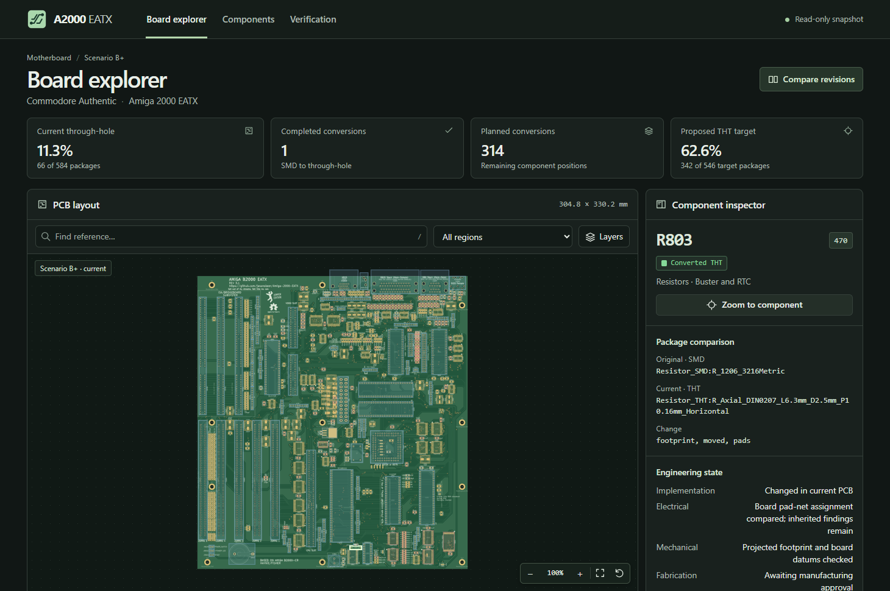

# Scenario B+ PCB dashboard

Inspect Jason Beer's original EATX board alongside the current Scenario B+ implementation. The checked-in site includes all geometry, component records and verification results needed for local review.

## Local preview

From the repository root, run the following command with Python 3. On macOS and Linux, the executable may be named `python3`.

```sh
python -m http.server 8000 --bind 127.0.0.1 --directory dashboard
```

Open [the local dashboard](http://127.0.0.1:8000/). Stop the server with Ctrl+C. The browser reads local JSON and SVG over HTTP. It can operate with the internet disconnected. Opening a source-document link on GitHub requires internet access.



## Inspect the board

- **Board explorer** opens on the component side. Hover to identify a footprint, select it to inspect its package and nets, and use **Zoom to component** for its local geometry. Wheel to zoom and drag to pan. With the board focused, use the arrow keys, +, − and Home. Tablet users can pan by dragging and use the zoom buttons.
- Press **/** to find a reference. Search for **R803** to see the completed axial conversion, **CN605** to inspect a revised through-hole socket, or **ZS1** to see the discrete parts assigned to that proposed SIP. Expand **Termination branches** for the capacitor, independent junction, original element, proposed SIP pin and ground return.
- Select a functional region to frame the extents of its documented member footprints. Choose a status in the legend to filter the overlays and the selection targets. Physical copper remains visible. The five statuses have text labels in the legend, inspector and component register.
- **Layers** controls both sides' copper, the two internal copper layers, silkscreens, fabrication drawings, surface pad lands, vias, outline, status overlays and reference labels. Native copper plots contain their own copper lands. Silkscreen plots include actual printed references. The separate pad and label controls toggle their respective inspection overlays. Both boards are viewed from the component side, including when inspecting back copper.
- **Compare revisions** shows the original on the left and Scenario B+ on the right, with a shared millimetre coordinate system, zoom and pan. Dashed outlines identify changed records. Status colours on *both* boards describe the current disposition of the corresponding component. Use the inspector for the original and current footprint names and source references.
- **Components** contains the filterable register, physical-package counts and the projected count by category. **Verification** contains the source commit, recorded checks, comparison against the refilled control, engineering risks and links to source evidence.

## What the figures measure

The design snapshot at `f0c635ff` contains 614 inspection records. Of those, 584 are component positions and 30 are non-populated board features. The 65 originally through-hole packages and the converted R803 give 66 current THT packages (11.3%). The 314 remaining planned positions include 44 discrete elements assigned to six proposed SIPs. Counting those six bodies once gives a target of 342 THT packages out of 546 (62.6%). Assembly options are included in these design-position counts. See the [component register](../reports/pcb-progress/components.csv) and [machine-readable summary](../reports/pcb-progress/summary.json).

The historical inspector identifies the factory schematic or parts-list evidence and separately attributes geometry and contact mappings from the Rev 6.2 reconstruction. Missing information appears as **Not documented**. Verification is recorded separately for electrical checks, reviewed mechanical geometry, supplier acceptance and physical validation. The TE sockets are provisionally approved for layout. Fabricator capability, connector fit and representative termination measurements remain open. See the [historical comparison](../ORIGINAL_A2000_REV62_COMPARISON.md) and [implementation review](../SCENARIO_B_PLUS_IMPLEMENTATION.md).

## Regenerate from KiCad

Use a Git checkout with history, Python 3 and KiCad 10 including its CLI and `pcbnew` Python bindings. The committed assets were exported with KiCad 10.0.8. From the repository root run:

```sh
python tools/pcb-progress/build.py
```

If discovery fails, set `KICAD_PYTHON` to an interpreter that imports `pcbnew` and `KICAD_CLI` to the KiCad CLI executable. The exporter reads committed snapshots into temporary directories. Commit engineering inputs before using the default command, or pass `--source <commit>` to explicitly export a committed revision. The default baseline is Jason Beer's original `dfde4574`. The selected source is the latest commit affecting the engineering inputs at or before the requested revision. Dashboard-only commits do not advance that source.

The exporter records the source, baseline and PCB revisions, board SHA-256, KiCad version and UTC build time. Set `SOURCE_DATE_EPOCH` to a Unix timestamp to fix the report date on repeated builds. Required inputs are checked before publishing generated assets. If the design has moved beyond the archived verification evidence, the page labels those results as an earlier snapshot.

| Output | Source and purpose |
| --- | --- |
| `dashboard/data/{original,current}/board.json` | KiCad footprint origins, pad coordinates, net assignments, via count and Edge.Cuts bounds in board millimetres |
| `dashboard/data/{original,current}/*.svg` | Native KiCad copper, stored fills, silkscreen and fabrication plots, plus board, pad and via geometry drawn from the PCB |
| `dashboard/data/manifest.json` | Joins both boards, baseline and B+ component plans, termination crosswalk, historical records, regions and verification reports |
| `reports/pcb-progress/` | Component CSV and summary JSON from the same manifest, plus the initial browser snapshot |

When implementing a rename or SIP consolidation, update the accepted physical-package mapping and termination crosswalk in the engineering source. A SIP becomes implemented only when its new THT body exists, the superseded packages have retired and its private junctions and common ground agree with the map. A changed pad stack on an existing THT socket retains its original-THT classification.

## Validate

From the repository root run:

```sh
python tools/pcb-progress/test_export.py
```

The browser check uses Python Playwright and Chromium. In a test environment run:

```sh
python -m pip install playwright==1.65.2
python -m playwright install chromium
python tools/pcb-progress/test_browser.py
```

Alternatively, pass `--browser <path-to-Chrome-or-Edge>` to use an installed browser. The test serves the site under `/Amiga-2000-EATX/`, blocks external requests, exercises selection and synchronized comparison, checks tablet layout and injects a missing manifest to test the warning. The export tests compare the baseline pads to the independent audit, check the committed PCB hash, and exercise SIP mapping and package counts.

## Optional GitHub Pages

The [optional Actions workflow template](../tools/pcb-progress/pcb-dashboard.workflow.yml) is included for maintainer review. To activate it with separate approval, a maintainer with workflow-write access can install it at `.github/workflows/pcb-dashboard.yml`. The template regenerates from full Git history in a pinned KiCad container, validates the export and runs browser tests on relevant pushes. Ordinary pushes only run checks after installation.

Publication requires the installed workflow to be available for manual dispatch on the default branch, Pages to be configured for GitHub Actions, and an authorized maintainer to dispatch it for the desired revision with **publish** selected. Only the deployment job receives Pages write and OpenID token permissions. The build uses read-only repository access. A failed check prevents deployment. The committed static files can be served directly using the local preview command regardless of workflow installation.

The side-by-side comparison uses saved KiCad geometry. Physical test outcomes, newly measured waveforms and supplier acceptance must be added to the source evidence as they become available.
